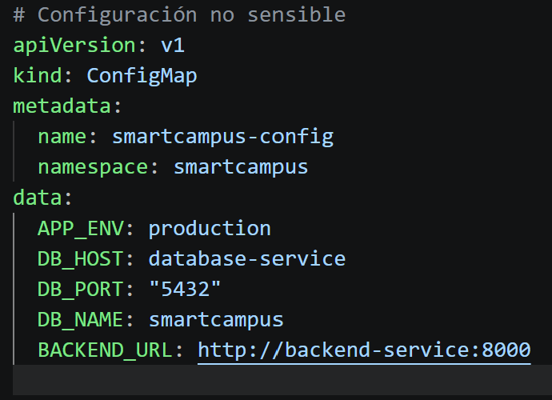
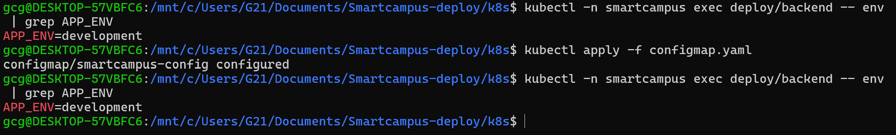
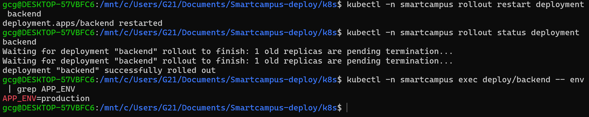

# SmartCampus Deploy

Práctica 2 de Despliegue y Monitorización en la Nube (UCJC): despliegue de la plataforma SmartCampus (gestión de aulas y reservas) con Docker Compose y Kubernetes.

## Arquitectura

```
Navegador --> frontend (nginx) --/api/--> backend (FastAPI) --SQL--> database (PostgreSQL)
```

- **frontend**: HTML/CSS/JS estático servido por nginx. nginx reenvía `/api/` al backend, así el navegador solo habla con un origen (sin CORS).
- **backend**: API REST con FastAPI y psycopg.
- **database**: PostgreSQL 16 (imagen oficial), con `database/init.sql` para tablas y datos de ejemplo.

## Estructura

```
backend/          API (app/, tests/, Dockerfile)
frontend/         web/ (HTML, CSS, JS), nginx.conf.template, Dockerfile
database/         init.sql
k8s/              manifiestos de Kubernetes (namespace, ConfigMap, Secret, BD, backend, frontend)
docs/             memoria.md, problemas.md y capturas/
docker-compose.yml
.env.example
```

## Cómo ejecutarlo (Docker Compose)

```bash
cp .env.example .env        # cambiar DB_PASSWORD
docker compose up -d --build
docker compose ps
```

- Web: http://localhost:8080
- API: http://localhost:8000 (documentación en `/docs`)

Parar:

```bash
docker compose down         # conserva los datos de la BD
docker compose down -v      # borra también el volumen
```

Si el puerto 5432 de tu máquina está ocupado, cambia `DB_PUBLISHED_PORT` en `.env` (ver `docs/problemas.md`).

## Cómo ejecutarlo (Kubernetes)

Con Minikube y `kubectl` instalados:

```bash
minikube start -p smartcampus --driver=docker
minikube -p smartcampus image build -t smartcampus-backend:1.0 backend
minikube -p smartcampus image build -t smartcampus-frontend:1.0 frontend
kubectl apply -f k8s/namespace.yaml
kubectl apply -f k8s/
kubectl -n smartcampus get pods
minikube -p smartcampus service frontend-service -n smartcampus
```

Escalar el backend y comprobar el self-healing:

```bash
kubectl -n smartcampus scale deployment backend --replicas=4
kubectl -n smartcampus delete pod <nombre-del-pod>
```

Borrar todo: `kubectl delete namespace smartcampus`. Los valores de `k8s/secret.yaml` son de desarrollo.

## Endpoints del backend

| Método | Ruta | Descripción |
|---|---|---|
| GET | `/health` | Liveness: `{"status":"ok"}` |
| GET | `/health/db` | Comprueba la conexión con la BD |
| GET, POST | `/rooms` | Listar / crear aulas |
| GET, DELETE | `/rooms/{id}` | Ver / borrar un aula |
| GET, POST | `/bookings` | Listar / crear reservas |
| GET, DELETE | `/bookings/{id}` | Ver / borrar una reserva |

## Tests del backend

```bash
cd backend
pip install -r requirements.txt
pytest
```

## Estado del proyecto

### Hecho y probado
- Backend FastAPI con PostgreSQL y todos los endpoints (obligatorios y opcionales).
- Frontend con nginx: listado, alta y borrado de aulas y reservas.
- `database/init.sql` con tablas y datos de ejemplo.
- Dockerfiles de backend y frontend.
- `docker-compose.yml` con los tres servicios: red propia, volumen para la BD, healthchecks, `depends_on` con `service_healthy` y `restart: unless-stopped`.
- Pruebas de Docker Compose con capturas en `docs/capturas/`:
  - construcción, `docker compose ps` y aplicación funcionando;
  - comunicación frontend → backend → BD;
  - persistencia de datos tras `docker compose down` y `up`;
  - caída del backend: `docker stop`/`kill` no lo reinician (parada manual) y un fallo real sí, gracias a `restart: unless-stopped`.
- Manifiestos de Kubernetes en `k8s/`: namespace, ConfigMap, Secret, StatefulSet de la BD, Deployments y Services.
- Pruebas en Minikube con capturas: despliegue, escalado del backend, self-healing y cambio del ConfigMap.
- Memoria técnica completa en `docs/memoria.md`: arquitectura, comparativa, las 20 preguntas, problemas y conclusiones.

### Pendiente
- Revisión final de la memoria y entrega.

## Capturas

La explicación de cada prueba está en [docs/memoria.md](docs/memoria.md).

### Docker Compose

| | |
|---|---|
| **01** Construcción de las imágenes |  |
| **02** `docker compose ps`: servicios en ejecución y `healthy` |  |
| **03** Aplicación funcionando |  |
| **04** `curl` a `/health`, `/health/db` y `/rooms` |  |
| **05** Persistencia: creación de un aula |  |
| **06** Persistencia: datos tras `down` y `up` |  |
| **07** Fallo: backend parado con `docker stop`/`kill` |  |
| **08** Fallo: web con el backend parado |  |
| **09** Fallo: recuperación manual |  |
| **10** Fallo: reinicio automático con `restart` |  |

### Kubernetes

| | |
|---|---|
| **11** `kubectl apply` |  |
| **12** Pods, services y deployments |  |
| **13** Aplicación funcionando en Kubernetes |  |
| **14** Escalado del backend a 4 réplicas |  |
| **15** Escalado de vuelta a 2 réplicas |  |
| **16** Self-healing: borrado de un pod |  |
| **17** Self-healing: pod recreado |  |
| **18** ConfigMap: edición |  |
| **19** ConfigMap: `apply` sin reiniciar los pods |  |
| **20** ConfigMap: valor nuevo tras `rollout restart` |  |
