# Memoria técnica: SmartCampus en Docker y Kubernetes

## 1. Introducción

SmartCampus es una plataforma para gestionar aulas y reservas de espacios universitarios. El objetivo de esta práctica es desplegar la misma aplicación de dos formas, con Docker Compose y con Kubernetes, y comparar ambos enfoques: cómo se construyen las imágenes, cómo se comunican los servicios, qué ocurre cuando algo falla y cómo se escala.

## 2. Arquitectura

La aplicación se divide en tres componentes independientes:

```
Navegador --> frontend (nginx) --/api/--> backend (FastAPI) --SQL--> database (PostgreSQL)
```

| Componente | Tecnología | Función |
|---|---|---|
| frontend | HTML, CSS y JavaScript servidos por nginx | Interfaz web: lista, crea y borra aulas y reservas |
| backend | FastAPI (Python) y psycopg | API REST con la lógica de negocio |
| database | PostgreSQL 16 (imagen oficial) | Almacena aulas y reservas |

**Modelo de datos**
- Aula: `id`, `nombre`, `edificio`, `capacidad`, `equipamiento` (lista).
- Reserva: `id`, `aula_id`, `usuario`, `fecha`, `hora_inicio`, `hora_fin`. Una reserva pertenece a un aula y no puede solaparse con otra del mismo aula y día.

**API del backend**

| Método | Ruta | Descripción |
|---|---|---|
| GET | `/health` | Comprueba que el proceso responde (`{"status":"ok"}`) |
| GET | `/health/db` | Comprueba la conexión con la base de datos |
| GET, POST | `/rooms` | Listar y crear aulas |
| GET, DELETE | `/rooms/{id}` | Consultar y borrar un aula |
| GET, POST | `/bookings` | Listar y crear reservas |
| GET, DELETE | `/bookings/{id}` | Consultar y borrar una reserva |

`/health` y `/health/db` están separados a propósito: el primero indica que el proceso está vivo (liveness) y el segundo que además puede hablar con la base de datos (readiness).

**Decisión: el navegador solo habla con nginx.** El frontend llama siempre a rutas relativas (`/api/...`) y nginx las reenvía al backend. Así no hay problemas de CORS y el navegador no necesita resolver el nombre interno del backend, que solo existe dentro de la red de Docker (o del clúster en Kubernetes). La dirección del backend se configura con la variable `BACKEND_URL`, de modo que la misma imagen sirve en Compose (`http://backend:8000`) y, más adelante, en Kubernetes.

## 3. Despliegue con Docker

### 3.1 Imágenes

**Backend** (`backend/Dockerfile`)
- Base `python:3.12-slim`.
- Se copian y se instalan primero los `requirements.txt` y después el código, para aprovechar la caché de capas: si solo cambia el código, las dependencias no se reinstalan.
- Se ejecuta con un usuario sin privilegios (`appuser`).
- La conexión a la base de datos se configura con variables de entorno (`DB_HOST`, `DB_PORT`, `DB_NAME`, `DB_USER`, `DB_PASSWORD`); la imagen no contiene credenciales.

**Frontend** (`frontend/Dockerfile`)
- Base `nginx:1.27-alpine`.
- Los archivos estáticos se copian a `/usr/share/nginx/html`.
- La configuración de nginx es una plantilla (`nginx.conf.template`) en la que la imagen sustituye `BACKEND_URL` al arrancar.

**Base de datos**
- Se usa la imagen oficial `postgres:16` sin modificar. `database/init.sql` crea las tablas y datos de ejemplo.

### 3.2 Docker Compose

El archivo `docker-compose.yml` define tres servicios en una red propia (`smartcampus-net`):

| Servicio | Puerto en el equipo | Puntos clave |
|---|---|---|
| `database` | 5433 (solo depuración) | Volumen `smartcampus-db-data`, `init.sql` montado en `docker-entrypoint-initdb.d`, healthcheck con `pg_isready` |
| `backend` | 8000 | Variables de entorno desde `.env`, espera a que la base de datos esté `healthy`, healthcheck sobre `/health/db` |
| `frontend` | 8080 | Espera a que el backend esté `healthy`, `BACKEND_URL=http://backend:8000` |

Aspectos de configuración:
- **Service discovery:** los servicios se encuentran por nombre dentro de la red (`database`, `backend`). El backend usa `DB_HOST=database`, no `localhost`.
- **Orden de arranque:** `depends_on` con `condition: service_healthy` evita que el backend arranque antes de que PostgreSQL acepte conexiones.
- **Persistencia:** el volumen nombrado conserva los datos aunque se eliminen los contenedores.
- **Credenciales y puertos:** se leen del archivo `.env` (no versionado); `.env.example` documenta las variables.
- **Resiliencia:** `restart: unless-stopped` en todos los servicios.

`init.sql` solo se ejecuta cuando el volumen de datos está vacío. Si se modifica, hay que recrear el volumen con `docker compose down -v`.

### 3.3 Cómo ejecutarlo

```bash
cp .env.example .env
docker compose up -d --build
docker compose ps
```

Web en http://localhost:8080 y API en http://localhost:8000.

## 4. Despliegue en Kubernetes

Se usa Minikube (driver Docker) con un perfil propio, `smartcampus`, y todos los recursos viven en el namespace `smartcampus`. Las imágenes del backend y del frontend se construyen dentro del clúster con `minikube image build` (`smartcampus-backend:1.0` y `smartcampus-frontend:1.0`, con `imagePullPolicy: IfNotPresent` porque no están en ningún registro). La base de datos usa `postgres:16`.

### 4.1 Recursos (`k8s/`)

| Archivo | Recurso | Función |
|---|---|---|
| `namespace.yaml` | Namespace | Agrupa los recursos de la práctica |
| `configmap.yaml` | ConfigMap `smartcampus-config` | `APP_ENV`, `DB_HOST`, `DB_PORT`, `DB_NAME` y `BACKEND_URL` |
| `secret.yaml` | Secret `smartcampus-secret` | `DB_USER` y `DB_PASSWORD` |
| `database-init-configmap.yaml` | ConfigMap `database-init` | Contiene `init.sql`, montado en `/docker-entrypoint-initdb.d` |
| `database-deployment.yaml` | StatefulSet `database` | PostgreSQL, 1 réplica y un disco propio de 1Gi |
| `database-service.yaml` | Service `database-service` | Headless (`clusterIP: None`): nombre estable para la BD |
| `backend-deployment.yaml` | Deployment `backend` | 2 réplicas, con probes sobre `/health/db` y `/health` |
| `backend-service.yaml` | Service `backend-service` | ClusterIP, puerto 8000 |
| `frontend-deployment.yaml` | Deployment `frontend` | 1 réplica |
| `frontend-service.yaml` | Service `frontend-service` | NodePort 30080: expone la web fuera del clúster |

### 4.2 Decisiones

- **StatefulSet para la BD.** Un Deployment trata sus Pods como intercambiables y sin identidad. Una base de datos necesita un nombre estable (`database-0`) y un volumen propio que vuelva a asignarse al mismo Pod si se recrea. El StatefulSet da ambas cosas con `volumeClaimTemplates`. Con una sola réplica no hay replicación de datos, pero es la elección correcta para un servicio con estado.
- **Comunicación por Services, no por IP.** El backend usa `DB_HOST=database-service` y el frontend `BACKEND_URL=http://backend-service:8000`. El Service da un nombre y una IP estables y reparte las peticiones entre los Pods del backend.
- **ConfigMap.** Guarda la configuración no sensible. El backend la carga entera con `envFrom`, el frontend toma `BACKEND_URL` con `configMapKeyRef` y la BD lee `DB_NAME`.
- **Secret.** Guarda `DB_USER` y `DB_PASSWORD`, que se inyectan como variables de entorno y no aparecen en los Deployments ni en las imágenes. Sus valores van en base64, que no es cifrado: cualquiera con permiso de lectura sobre Secrets del namespace puede decodificarlos, y por defecto se almacenan sin cifrar en etcd. Un sistema especializado (HashiCorp Vault, AWS Secrets Manager) añade cifrado, control de acceso fino, rotación de credenciales y auditoría. Los valores del repositorio son solo de desarrollo; en un entorno real el Secret se crearía fuera de Git.
- **Probes.** La readiness del backend consulta `/health/db`: un Pod que no llega a la BD no recibe tráfico. La liveness consulta `/health`: si el proceso no responde, se reinicia el contenedor.
- **Exposición.** `frontend-service` es NodePort (30080). Con el driver Docker el nodo no es accesible directamente desde el equipo, así que `minikube service` abre un túnel y da una URL local (`127.0.0.1:puerto`).

### 4.3 Cómo desplegarlo

```bash
minikube start -p smartcampus --driver=docker
minikube -p smartcampus image build -t smartcampus-backend:1.0 backend
minikube -p smartcampus image build -t smartcampus-frontend:1.0 frontend
kubectl apply -f k8s/namespace.yaml
kubectl apply -f k8s/
minikube -p smartcampus service frontend-service -n smartcampus
```

El namespace se aplica primero porque `kubectl apply -f` procesa los archivos por orden alfabético y `namespace.yaml` quedaría después de los `backend-*`.

## 5. Pruebas y evidencias

### 5.1 Docker Compose

**Experimento 1: despliegue y funcionamiento**

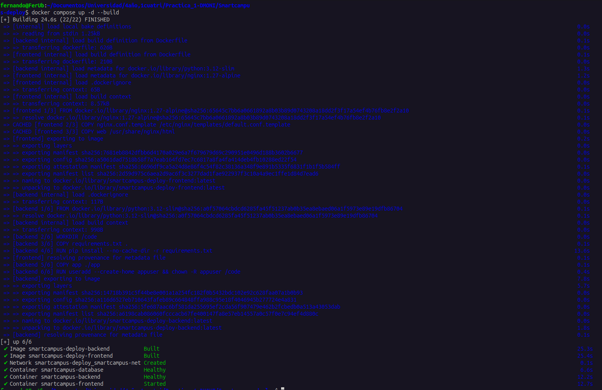

Construcción de las imágenes con `docker compose up -d --build`.

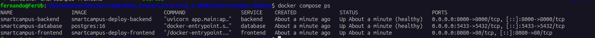

`docker compose ps`: los tres servicios en ejecución; la base de datos y el backend con estado `healthy`.

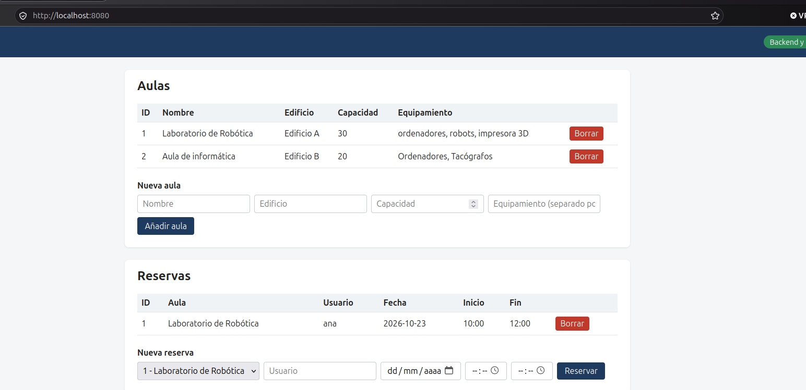

La web carga las aulas y reservas obtenidas del backend, lo que confirma la cadena frontend → backend → base de datos.

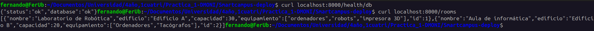

Comprobación directa de la API: `/health` responde, `/health/db` confirma la conexión con PostgreSQL y `/rooms` devuelve los datos cargados desde `init.sql`.

**Persistencia de datos**

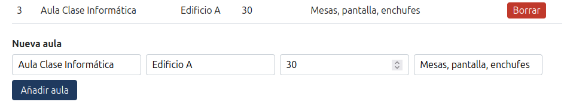

Se crea un aula desde la web.

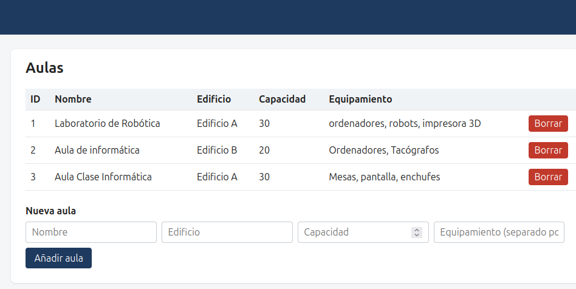

Tras `docker compose down` (sin `-v`) y `docker compose up -d`, el aula sigue existiendo: los datos viven en el volumen, no en el contenedor.

**Experimento 2: fallo de un contenedor**

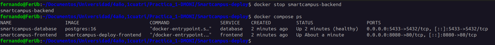

Se detiene el backend con `docker stop` / `docker kill`. No se reinicia: Docker lo interpreta como una parada manual y no aplica `restart: unless-stopped`.

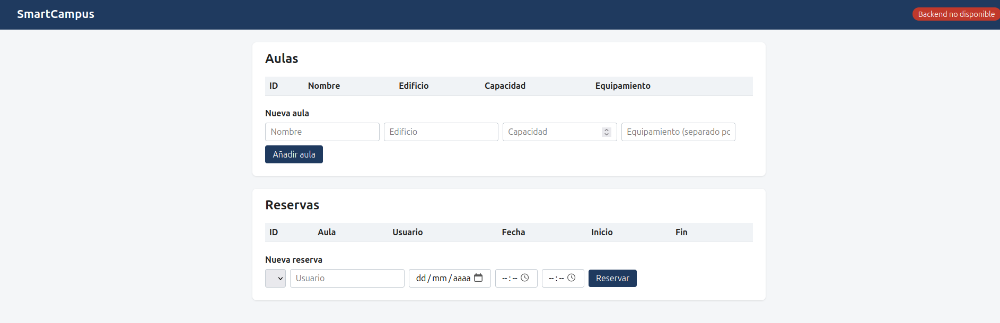

Con el backend parado, el frontend sigue sirviéndose pero indica que el backend no está disponible. La caída de un servicio no tumba a los demás.

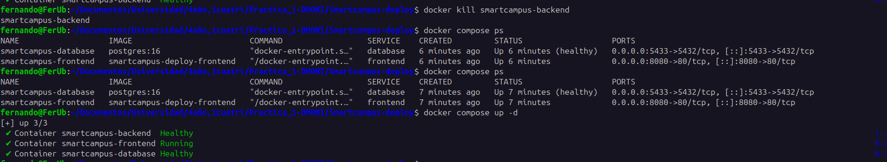

Recuperación manual: `docker compose up -d` vuelve a crear el contenedor que faltaba.

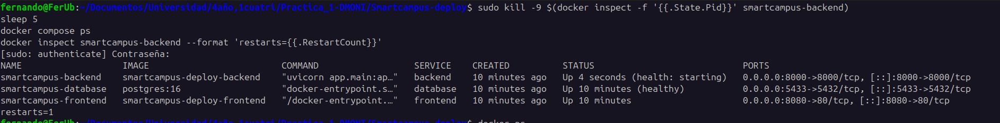

Fallo real simulado matando el proceso desde el host (`kill -9`). Docker reinicia el contenedor por su cuenta (`restarts=1`) y pasa de `health: starting` a `healthy`.

Conclusión del experimento: Compose no recupera un contenedor parado a mano, y solo recupera automáticamente los fallos si el servicio tiene una política `restart`. No hay un componente que mantenga un número de réplicas deseado.

### 5.2 Kubernetes

**Experimento 3: despliegue**

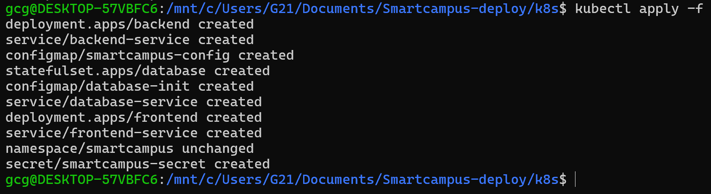

`kubectl apply -f .` crea todos los recursos de `k8s/`.

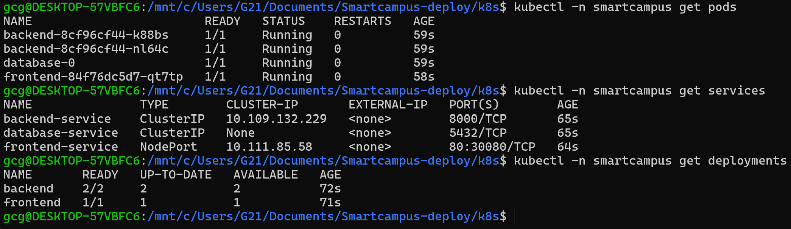

Los 4 Pods en `Running` (2 de backend, la base de datos y el frontend), los tres Services (`database-service` sin IP por ser headless, `frontend-service` como NodePort) y los Deployments `backend` 2/2 y `frontend` 1/1.

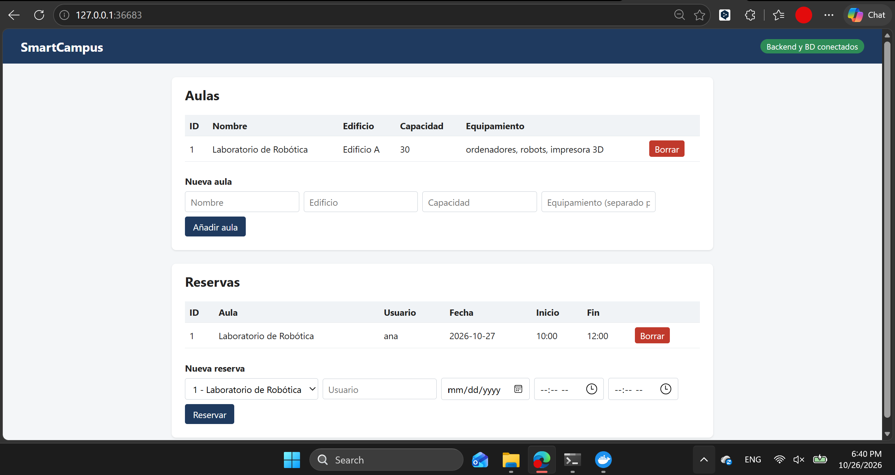

La web, abierta con `minikube service`, carga aulas y reservas y muestra "Backend y BD conectados": frontend → `backend-service` → `database-service` funciona.

**Experimento 4: escalado**

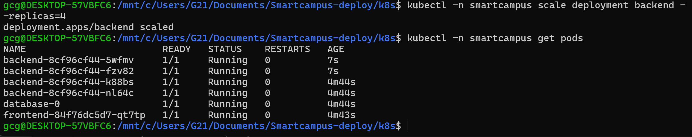

`kubectl scale deployment backend --replicas=4`: Kubernetes crea dos Pods nuevos (7 s de edad) y mantiene los dos originales.

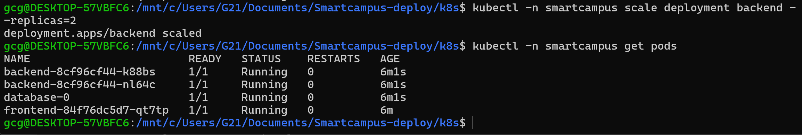

Al volver a `--replicas=2` se eliminan los Pods sobrantes y quedan 2.

**Experimento 5: self-healing**

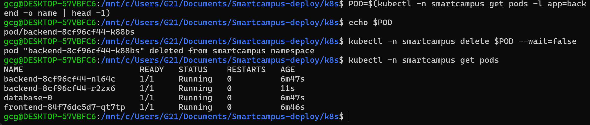

Se borra `backend-8cf96cf44-k88bs` con `kubectl delete pod`. En el siguiente `get pods` ya existe `backend-8cf96cf44-r2zx6`, creado para sustituirlo (11 s de edad).

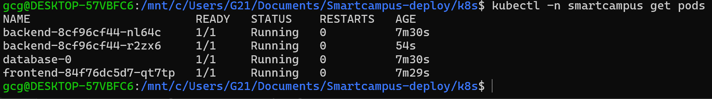

El backend vuelve a tener 2 Pods en `Running`.

- **Pod eliminado:** `backend-8cf96cf44-k88bs`.
- **Qué ocurrió después:** Kubernetes creó `backend-8cf96cf44-r2zx6` en segundos, sin intervención.
- **Qué recurso lo mantiene:** el ReplicaSet que crea el Deployment `backend`, que compara las réplicas existentes con las deseadas (2) y crea las que faltan.
- **Diferencia con Docker:** un contenedor borrado con Docker (o con Compose) no se repone solo (experimento 2). Aquí el estado deseado vive en un controlador que lo restablece.

**Experimento 6: cambio de ConfigMap**

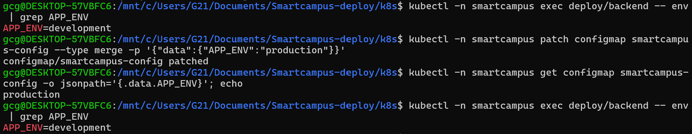

Se cambia `APP_ENV` de `development` a `production` en el ConfigMap. El ConfigMap ya dice `production`, pero el Pod en ejecución sigue con `APP_ENV=development`: las variables de entorno se leen al arrancar el contenedor y no se actualizan en caliente.

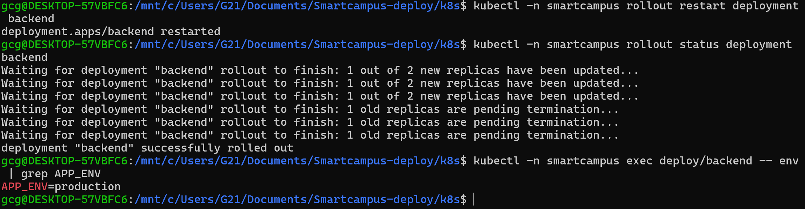

`kubectl rollout restart deployment backend` sustituye los Pods por otros nuevos de forma progresiva y estos ya tienen `APP_ENV=production`. Los Pods que usan el ConfigMap solo ven el cambio al recrearse.

## 6. Comparativa Docker Compose y Kubernetes

| Característica | Docker Compose | Kubernetes |
|---|---|---|
| Ejecución local | Un comando (`docker compose up`) y solo requiere Docker | Requiere un clúster (Minikube) y `kubectl`; más pasos y más recursos para arrancar |
| Orquestación | Arranca un conjunto de contenedores en un único equipo | Controladores (Deployment, StatefulSet) mantienen el estado deseado de los Pods en uno o varios nodos |
| Escalado | `docker compose up --scale servicio=N`, manual y en un equipo | `kubectl scale` (probado de 2 a 4 y de vuelta a 2) y HorizontalPodAutoscaler opcional |
| Self-healing | Solo con `restart`; no repone contenedores borrados o parados a mano | El ReplicaSet recrea los Pods borrados (experimento 5) y la liveness probe reinicia contenedores bloqueados |
| Service discovery | DNS interno por nombre de servicio dentro de la red del proyecto | DNS del clúster por nombre de Service (`backend-service`, `database-service`) con IP estable |
| Configuración | Variables en el compose y archivo `.env` | ConfigMap como objeto aparte; los Pods no lo ven hasta reiniciarse (experimento 6) |
| Secrets | Variables o archivos, sin gestión específica | Objeto Secret separado de los Deployments y con control de acceso; en base64, sin cifrado por defecto |
| Alta disponibilidad | No: depende de un único equipo | Réplicas repartidas en varios nodos y Pods reprogramados si un nodo cae (en Minikube hay un solo nodo, no se probó) |
| Balanceo | El DNS interno devuelve las réplicas por nombre, pero con puertos publicados no pueden compartir el mismo puerto | El Service reparte las peticiones entre los Pods que están Ready; LoadBalancer o Ingress para la entrada |
| Actualizaciones | `up -d` recrea el contenedor con una breve parada | Rolling update sin cortar el servicio (`rollout restart`, experimento 6) y vuelta atrás con `rollout undo` |
| Complejidad | Baja: un archivo | Alta: 10 manifiestos y conceptos propios (Pod, Service, probes, StatefulSet) |
| Uso habitual | Desarrollo local, pruebas y proyectos pequeños | Producción con varios servicios, escalado y alta disponibilidad |

## 7. Problemas encontrados

Resumidos aquí y detallados en [problemas.md](problemas.md):

1. Backend `unhealthy` por conflicto del puerto 5432 en el equipo, con el contenedor de la base de datos sin red.
2. El backend no se reiniciaba tras `docker stop`/`docker kill` porque Docker lo trata como parada manual.
3. `minikube image build` del frontend fallaba con "open Dockerfile: no such file" porque `frontend/.dockerignore` excluía el propio `Dockerfile`.
4. Con otro proyecto ya en marcha, Compose no podía crear `smartcampus-backend` (nombre de contenedor fijo en uso) ni usar el puerto 8000.

## 8. Preguntas

**1. Diferencias entre un contenedor Docker y un Pod.** Un contenedor es una unidad aislada que ejecuta un proceso con su propio sistema de archivos. Un Pod es la unidad mínima de Kubernetes y envuelve uno o varios contenedores que comparten red (una IP y un espacio de puertos) y almacenamiento. Un contenedor se gestiona directamente con Docker; un Pod lo gestiona un controlador (Deployment, StatefulSet) que lo recrea si desaparece.

**2. Qué problema resuelve Docker Compose.** Permite describir en un único archivo una aplicación formada por varios contenedores (imágenes, redes, volúmenes, variables, dependencias, etc) y levantarla o pararla con un comando, en lugar de lanzar y conectar cada contenedor a mano con `docker run`.

**3. Problemas adicionales que intenta resolver Kubernetes.** Mantener un número deseado de réplicas aunque fallen (self-healing), escalar y repartir carga entre varios nodos, actualizar sin cortar el servicio y poder volver atrás, descubrir servicios por nombre con IPs estables, y gestionar configuración, secretos y almacenamiento como objetos propios.

**4. Qué ocurre si se borra a mano un contenedor de Compose.** El contenedor desaparece y Compose no lo repone por sí mismo: `restart` no actúa ante una parada o borrado manual. Hay que volver a ejecutar `docker compose up -d`. Se comprobó en el experimento 2.

**5. Qué ocurre si se elimina un Pod gestionado por un Deployment.** El ReplicaSet detecta que hay menos réplicas de las deseadas y crea otro Pod. En el experimento 5 se borró `backend-8cf96cf44-k88bs` y en segundos apareció `backend-8cf96cf44-r2zx6`.

**6. Cómo descubre servicios Kubernetes.** Con el DNS interno del clúster: cada Service tiene un nombre que resuelve a su IP estable (el nombre completo es `backend-service.smartcampus.svc.cluster.local`). Aquí el backend usa `DB_HOST=database-service` y el frontend `http://backend-service:8000`.

**7. Por qué no usar la IP de un Pod.** Es efímera: cambia cada vez que el Pod se recrea, ya sea por self-healing, escalado o actualización. Un Service ofrece un nombre y una IP que no cambian. En el experimento 5 el Pod sustituto es otro Pod, con otro nombre y otra IP.

**8. Función de un Deployment.** Declara el estado deseado de una aplicación stateless (imagen y número de réplicas) y se encarga de mantenerlo mediante un ReplicaSet. Permite escalar, actualizar con rolling update y volver a una versión anterior.

**9. Función de un Service.** Da una IP y un nombre DNS estables delante de un conjunto de Pods, que selecciona por etiquetas, y reparte las peticiones entre los que están Ready. Según el tipo, es interno (ClusterIP), se expone en un puerto del nodo (NodePort) o usa un balanceador externo (LoadBalancer).

**10. Deployment frente a StatefulSet.** En un Deployment los Pods son intercambiables, con nombres aleatorios (`backend-8cf96cf44-k88bs`) y se crean o borran en cualquier orden. En un StatefulSet cada Pod tiene un nombre estable y ordenado (`database-0`), arranca en orden y conserva su propio volumen (`volumeClaimTemplates`) cuando se recrea. Necesita un Service headless que dé nombre a cada Pod.

**11. Por qué una BD requiere otro tratamiento que una API stateless.** La API no guarda nada, así que cualquier réplica sirve y se puede borrar sin consecuencias. La BD guarda los datos: necesita disco persistente, identidad estable y no se escala solo añadiendo réplicas, porque cada una tendría datos distintos si no hay replicación. Por eso se usó un StatefulSet con 1 réplica.

**12. Qué problema solucionan ConfigMap y Secret.** Separan la configuración del código y de la imagen: la misma imagen sirve en distintos entornos cambiando solo la configuración. El Secret hace lo mismo con los datos sensibles, que así no quedan dentro de la imagen ni en el Deployment.

**13. Cómo se escala con Compose.** Con `docker compose up -d --scale backend=N` se crean N contenedores del servicio. Tiene límites: solo en un equipo, sin balanceo automático si el servicio publica un puerto fijo (las réplicas chocarían) y sin autoescalado.

**14. Cómo se escala con Kubernetes.** Con `kubectl scale deployment backend --replicas=N`, o cambiando `replicas` en el manifiesto y volviendo a aplicarlo. Opcionalmente, un HorizontalPodAutoscaler lo hace según el uso de recursos. En el experimento 4 se pasó de 2 a 4 réplicas y de vuelta a 2.

**15. Qué sucede cuando un Pod falla.** Si falla su liveness probe, el kubelet reinicia el contenedor. Si el Pod desaparece (borrado o caída del nodo), su controlador crea otro. Si falla su readiness probe, el Service deja de enviarle tráfico sin reiniciarlo.

**16. Ventajas de Kubernetes con varios servicios.** Cada servicio se escala, se actualiza y se recupera por separado (por ejemplo, el backend a 4 réplicas sin tocar el frontend ni la BD), con descubrimiento por nombre, balanceo, configuración y secretos como objetos y comprobaciones de salud.

**17. Inconvenientes de Kubernetes frente a Compose.** Más complejidad y curva de aprendizaje (10 manifiestos frente a un solo archivo), necesita un clúster que consume recursos, el diagnóstico es más difícil porque hay más capas (Pods, Services, probes) y las imágenes tienen que estar disponibles para el clúster (aquí, construidas dentro de Minikube).

**18. Cuándo usar Compose.** Para desarrollo local, pruebas, demos y proyectos pequeños de un solo equipo, donde interesa levantar todo rápido y con poca complejidad.

**19. Cuándo usar Kubernetes.** Con varios servicios en producción, necesidad de escalar o de alta disponibilidad, actualizaciones sin caída, varios equipos o entornos, o cuando la aplicación va a un proveedor cloud.

**20. Cambios para llevarla de local a cloud.**
- Subir las imágenes a un registro (Docker Hub, ECR) y usarlas en `image`, en lugar de construirlas dentro de Minikube.
- Usar un clúster gestionado (EKS, AKS, GKE) en lugar de Minikube.
- Sustituir el disco local de la BD por un servicio gestionado (RDS, Cloud SQL) o por la StorageClass del proveedor.
- Exponer el frontend con un LoadBalancer o un Ingress con dominio y HTTPS, en lugar de un NodePort.
- Guardar los secretos en un gestor del proveedor, no en Git.
- Definir `requests` y `limits` de recursos, un HorizontalPodAutoscaler, monitorización y logs centralizados.

## 9. Conclusiones

- **Desarrollo local:** Docker Compose. Se levanta todo con un comando y se reconstruye rápido.
- **Pruebas:** Compose para pruebas de integración sencillas; Minikube cuando interesa comprobar el comportamiento real en Kubernetes (probes, réplicas, configuración).
- **Proyecto personal pequeño:** Compose en un único servidor, porque la complejidad de Kubernetes no se compensa.
- **Aplicación empresarial con varios servicios:** Kubernetes, por el self-healing, las actualizaciones sin caída y la gestión separada de configuración y secretos.
- **Aplicación que necesita escalar:** Kubernetes, que escala cada servicio por separado y reparte la carga entre nodos.

La práctica muestra que ambos despliegues funcionan con la misma aplicación y las mismas imágenes. La diferencia está en lo que ocurre cuando algo cambia o falla: Compose depende de que alguien actúe (`up -d`), mientras que Kubernetes restablece el estado deseado por sí mismo, a costa de más piezas y más complejidad.
